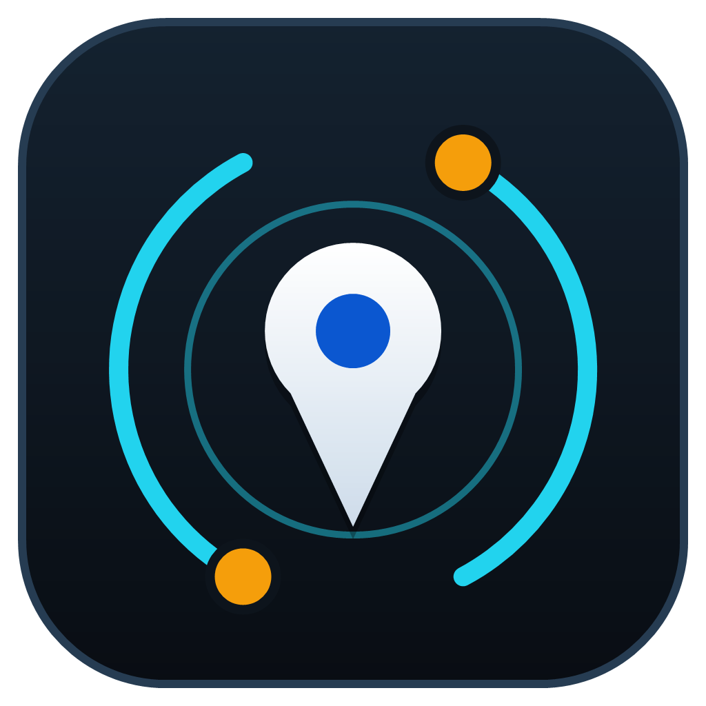

<p align="center"></p>

# GpsBridge

App Windows per ricevitori GPS u-blox (testata su un USB «G-Mouse» con chip M10): legge il ricevitore sulla porta
seriale, lo configura per usare **tutte le costellazioni** (GPS, Galileo, BeiDou, GLONASS, QZSS, SBAS) e offre
mappa, diagnostica, punti colorati, tracce GPX e posizione live in Google Earth. Senza driver da installare.

> English: a Windows (.NET 8 / WPF) desktop app for u-blox GPS receivers: auto-detects the serial port and baud rate,
> unlocks every GNSS constellation via UBX-CFG-VALSET, shows a live map (OSM / topo / satellite, offline tile cache),
> satellite diagnostics and sky plot, named & coloured waypoints, GPX recording (start/pause/stop/load) with trip stats and
> elevation profile, and streams the live position to Google Earth through a localhost KML NetworkLink (no virtual COM port needed).

## Funzioni

- **Collegamento automatico**: trova la porta e il baud (4800-230400), si ricollega se stacchi il cavo, ricorda l'ultima porta.
- **Configurazione del ricevitore** (u-blox M10, UBX-CFG-VALSET/VALGET): costellazioni (BeiDou su B1C per convivere con GLONASS),
  frequenza fino a 10 Hz, modello dinamico, frasi NMEA, baud UART. Legge prima e scrive solo se qualcosa cambia (la flash non si consuma);
  se il ricevitore rifiuta una combinazione, scende per priorità e ti mostra cosa è attivo davvero. Profilo migliore in RAM+BBR+flash con un clic,
  ripristino ai predefiniti u-blox.
- **Mappa**: OpenStreetMap, OpenTopoMap, Esri satellite, con cache su disco (funziona anche offline sulle zone già viste); posizione, traccia live, segui/libera.
- **Punti**: nome, colore (11 colori), note, quota; creazione dalla posizione, da coordinate scritte a mano (decimali, DMS, DDM) o con il tasto destro sulla mappa;
  modifica, elimina, importa/esporta GPX, mostra in Google Earth.
- **Navigazione**: scegli un punto e vedi distanza, rilevamento, di quanto girare e tempo di arrivo; linea tratteggiata sulla mappa.
- **Tracce GPX**: avvia / pausa / riprendi / stop e salva (il file è valido a ogni punto, anche se l'app si chiude male), carica un GPX qualunque;
  statistiche (distanza, durata, tempo in movimento, velocità media e massima, salita/discesa, quote) e profilo altimetrico.
- **Diagnostica**: fix, HDOP/PDOP/VDOP, satelliti per costellazione con SNR, cielo (skyplot), frasi al secondo, errori.
- **Google Earth**: «Apri in Google Earth» apre un KML (NetworkLink) che Earth ricarica ogni secondo da un mini server su `127.0.0.1`:
  posizione, traccia e punti colorati, e la vista ti segue. Niente porta COM virtuale né driver.
- **Aggiornamenti**: all'avvio controlla le [Releases](https://github.com/BadCactus634/GpsBridge/releases) di GitHub; se c'è una versione nuova ti avvisa e puoi scaricarla e installarla con un clic (verifica SHA-256; disattivabile in Impostazioni).
- **Tema chiaro, scuro o automatico** (come Windows): il chiaro è pensato per la luce del sole.
- **Unità e formati**: metriche / imperiali / nautiche; coordinate in gradi decimali, DMS, DDM o UTM.

## Requisiti

Windows 10/11 x64, ricevitore GPS u-blox con uscita NMEA/UBX su porta seriale (USB). Per compilare: .NET 8 SDK.
Per la mappa serve il runtime **WebView2** (già presente in Windows 11).

## Compilare ed eseguire

```powershell
dotnet build
dotnet test tests/GpsBridge.Core.Tests
dotnet run --project src/GpsBridge.App
# prova senza ricevitore: riproduce un file NMEA
dotnet run --project src/GpsBridge.App -- --replay tests/data/sample-multi-gnss.nmea
```

Installer (richiede [Inno Setup 6](https://jrsoftware.org/isinfo.php)):

```powershell
powershell -File tools/build-installer.ps1   # crea installer/output/GpsBridge-setup.exe
```

Per rilasciare una versione: alza `Version` in `src/GpsBridge.App/GpsBridge.App.csproj`, aggiorna `CHANGELOG.md`, esegui lo script,
poi `gh release create vX.Y.Z installer/output/GpsBridge-setup.exe`. L'app confronta il tag della release con la propria versione
e avvisa chi ha una versione più vecchia.

## Architettura

```
SerialSource (autobaud, riconnessione)  ->  FrameSplitter (NMEA + UBX nello stesso flusso)
    -> GnssState (fix, DOP, satelliti)  -> GpxRecorder (scrittura incrementale, pausa)
                                        -> KmlServer  (http://127.0.0.1:8765, NetworkLink)
    -> UbxConfigurator / ReceiverController (VALGET/VALSET con ACK/NAK)
WaypointStore (JSON + GPX), GpxReader/TrackStats, GeoMath (distanze, UTM, parsing coordinate), TileCache
```

`src/GpsBridge.Core` non ha interfaccia ed è coperto da test xUnit (si provano anche i flussi con un ricevitore finto); `src/GpsBridge.App` è la UI WPF.
Le impostazioni stanno in `%AppData%\GpsBridge\settings.json`, i punti in `waypoints.json`, le tracce in `Documenti\GpsBridge\Tracce`.

## Note

- Gli ID delle chiavi di configurazione u-blox sono stati verificati su un ricevitore reale (ROM SPG 5.10, PROTVER 34.10). Altri modelli/firmware possono rifiutare alcune chiavi: l'app lo segnala.
- La ricezione di tutte le costellazioni dipende dal cielo visibile: al chiuso se ne vedono poche.

## Licenza

Ideato e sviluppato da **Stefano Rossi** ([natmus.net](https://natmus.net), [@BadCactus634](https://github.com/BadCactus634)). MIT, vedi [LICENSE](LICENSE). Componenti di terze parti in [THIRD-PARTY.md](THIRD-PARTY.md).


